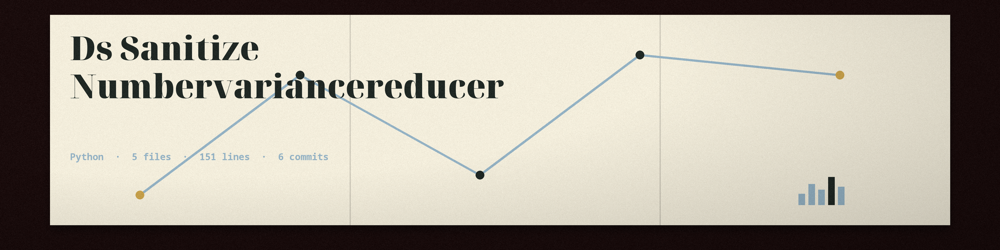

# ds-sanitize-NumberVarianceReducer
Command-line tool that reduces the precision of numerical data (e.g., rounding to nearest integer or specified decimal place) to minimize re-identification risks from statistical analysis. Accepts a CSV or JSON file and a column name as input. Uses the pandas library. - Focused on Tools for anonymizing and redacting sensitive data within datasets and files. Supports techniques like data masking, pseudonymization, and generalization to protect privacy while retaining data utility for testing and development. Uses libraries for data generation and dataframe manipulation.

## Install
`git clone https://github.com/ShadowStrikeHQ/ds-sanitize-numbervariancereducer`

## Usage
`./ds-sanitize-numbervariancereducer [params]`

## Parameters
- `-h`: Show help message and exit
- `--precision`: No description provided
- `--output_file`: The output file. It must not be the input file.
- `--in-place`: Overwrite the input file in place. Required when --output_file is not given.
- `--file_type`: Specify the file type: csv or json. If not specified, it will be inferred from the file extension.

## License
Copyright (c) ShadowStrikeHQ

## Notes
- Naming the input as --output_file is refused at exit 1, in the same spelling, a ./ spelling, and through a symlink.
- Running with neither --output_file nor --in-place exits 1 with a plain line naming the choice. Running with --in-place and no --output_file overwrites the input file, as documented.
